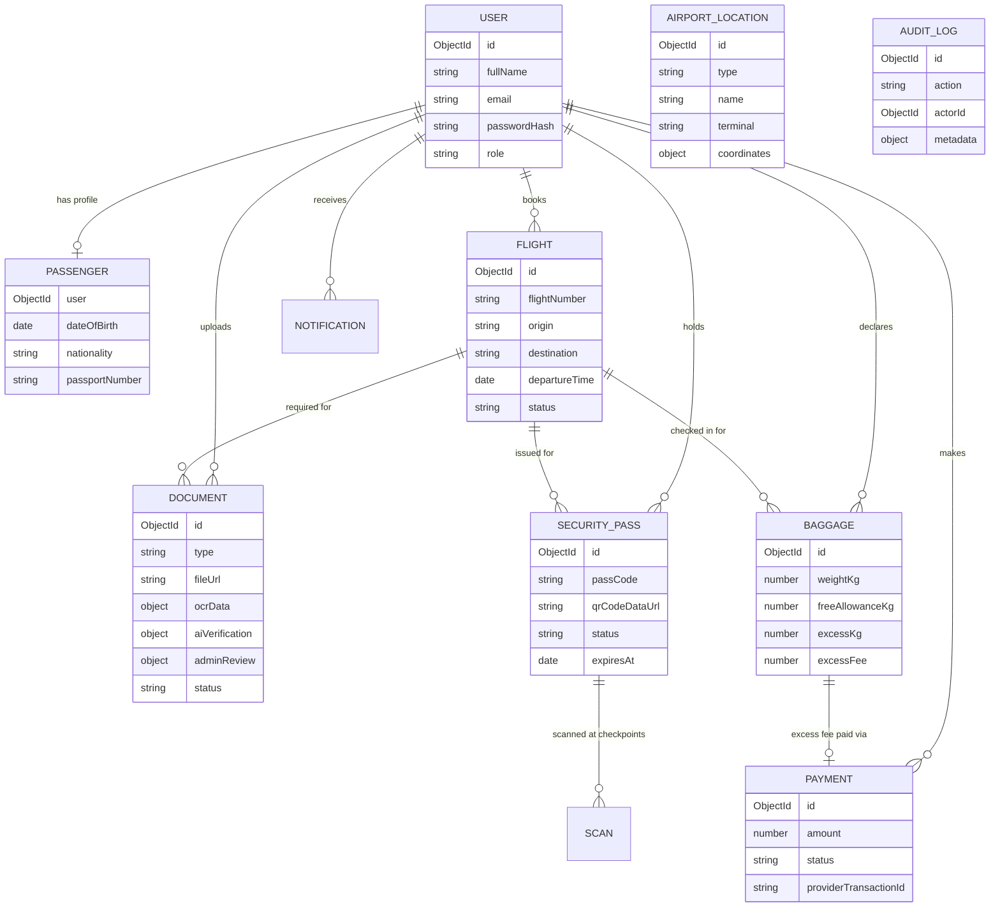

# Data model (ER overview)

Notes:
- `AIRPORT_LOCATION` and `AUDIT_LOG` are standalone collections (not tied to a
  single flight/user) and are omitted from the relationship arrows above for
  clarity.
- `SCAN` is an embedded sub-document array on `SECURITY_PASS.scans`, not a
  separate collection.
